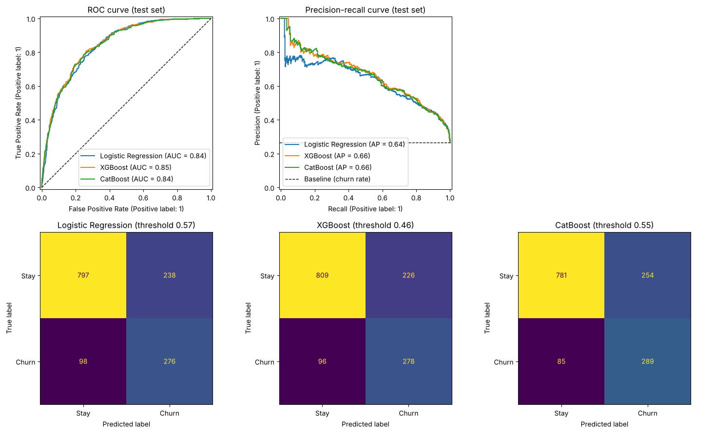
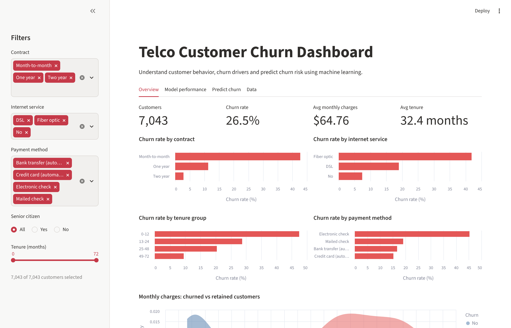
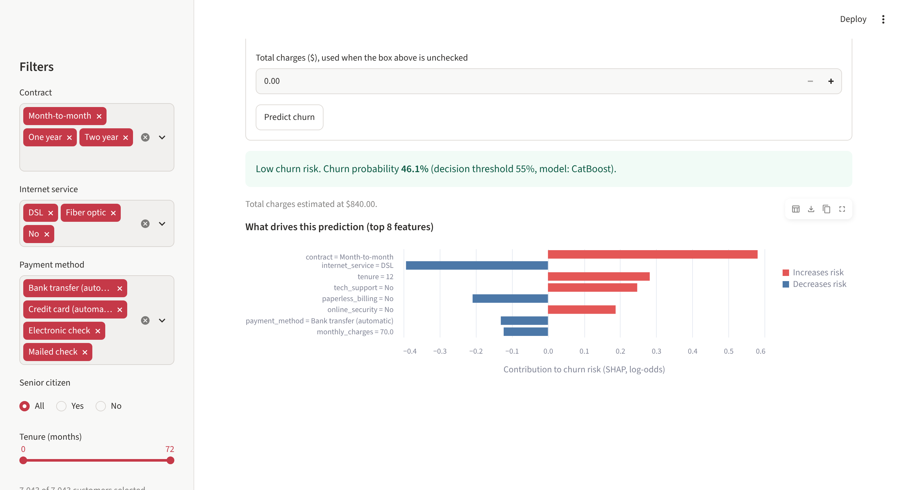

# Telco Customer Churn Analysis & Prediction

[](https://github.com/AlexNegulescu111/telco_costumer_churn_analysis/actions/workflows/main.yml)

This project focuses on analyzing customer churn in the telecom sector and predicting the likelihood of churn using machine learning models. It combines **business analysis**, **EDA**, **feature engineering**, and **model interpretability**, with an interactive **Streamlit dashboard** for BI and predictions.

---

## Business Objectives

- Analyze customer behavior and churn patterns
- Calculate key business KPIs (e.g., churn rate, average revenue)
- Build interpretable ML models to predict churn risk
- Provide an interactive dashboard for business stakeholders

---

## Key Findings & Recommendations

Churned customers represent **30.5% of monthly revenue** ($139k of $456k), more than their 26.5% share of customers, because they tend to pay more.

| Finding (churn rate) | Recommendation |
|---|---|
| **Contract**: month-to-month 42.7% vs one year 11.3% and two year 2.8%. 89% of churners are on month-to-month contracts. | Offer discounts or perks for moving to annual contracts, starting with high-risk month-to-month customers. |
| **Tenure**: 47.4% churn in the first 12 months vs 9.5% after 4 years. 56% of churners leave within their first year. | Run an onboarding and early-life retention programme for the first 12 months. |
| **Internet service**: fiber optic 41.9% vs DSL 19.0%. Fiber customers also pay more ($91.5 vs $58.1 per month on average). | Review fiber pricing and service quality, as fiber is the largest group of customers and has the highest churn. |
| **Support services**: churn is about 42% without tech support or online security vs about 15% with them. | Bundle tech support and online security into fiber and month-to-month plans, or offer free trials of them. |
| **Payment**: electronic check 45.3% vs 15-19% for automatic payments and mailed checks. | Encourage automatic payment methods (for example with a small billing credit). |

The model turns these patterns into a per-customer risk score. At the chosen threshold it flags 77% of the customers who churn, so retention offers can be targeted at the flagged customers instead of the whole base.

---

## Project Structure

```
telco_costumer_churn_analysis/
├── data/
│   ├── telco_customers.csv      # raw dataset (Kaggle)
│   └── kpi_summary.json         # business KPIs written by the pipeline
├── src/
│   ├── clean_data.py            # column renaming, total_charges fix
│   ├── kpi_analysis.py          # business KPIs
│   ├── preprocessing_model.py   # target encoding, feature selection, ColumnTransformer
│   ├── build_model.py           # train/test split, model pipelines
│   ├── tuning_model.py          # Optuna tuning with stratified CV
│   ├── evaluate_model.py        # metrics, threshold selection, evaluation plots
│   ├── explain_model.py         # per-customer SHAP explanations
│   ├── visualizations.py        # EDA plot helpers (used by the notebook)
│   └── utils.py                 # paths, data loading, JSON / model I/O
├── models/                      # trained pipeline, metadata, metrics, tuned hyperparameters
├── plots/                       # EDA plots, model evaluation and SHAP plots
├── dashboard/dashboard.py       # Streamlit dashboard
├── notebooks/eda.ipynb          # exploratory data analysis
├── tests/                       # pytest suite (unit tests, pipeline smoke test, dashboard test)
├── docs/                        # dashboard screenshots
├── run_pipeline.py              # end-to-end training pipeline
├── requirements.txt             # runtime dependencies
└── requirements-dev.txt         # + pytest, flake8, black
```

---

## Key KPIs (based on dataset)

| Metric                     | Value        |
|---------------------------|--------------|
| Total Customers           | 7043         |
| Churned Customers         | 1869         |
| Churn Rate                | 26.54%       |
| Avg Tenure (months)       | 32.37        |
| Avg Monthly Charges ($)   | 64.76        |
| Avg Total Charges ($)     | 2279.73      |

---

## Machine Learning Models

Implemented and compared: **Logistic Regression**, **XGBoost** and **CatBoost**.

### Methodology
- **Stratified 80/20 train/test split** at the start. The test set is used only once, for the final report.
- **Feature selection on the training set only**: chi-squared test (categorical) and Welch t-test (numerical), p < 0.05. `customer_id` is always excluded.
- **One scikit-learn `Pipeline` per model** (`ColumnTransformer` + estimator), fitted inside every CV fold:
  - Logistic Regression: one-hot encoding + standard scaling
  - XGBoost: one-hot encoding
  - CatBoost: native categorical handling
- **Hyperparameter tuning with Optuna** (seeded TPE sampler) using stratified 5-fold cross-validation on train, optimising **PR-AUC** (average precision).
- **Decision threshold** chosen to maximise F1 on out-of-fold training predictions, not the default 0.5.
- **Model selection** by cross-validated PR-AUC, never by test score.
- Metrics: ROC-AUC, PR-AUC, accuracy, precision, recall, F1 and confusion matrix, compared with a baseline that predicts the churn rate.
- Interpretability with **SHAP** (`plots/shap_importance.png`).

### Results

Test set (1,409 customers, never used for tuning, threshold or model selection):

| Model | ROC-AUC | PR-AUC | Precision | Recall | F1 |
|---|---|---|---|---|---|
| Logistic Regression | 0.842 | 0.636 | 0.537 | 0.738 | 0.622 |
| XGBoost | 0.848 | 0.664 | 0.552 | 0.743 | 0.633 |
| **CatBoost** (selected) | 0.845 | 0.661 | 0.532 | 0.773 | 0.630 |
| Baseline (churn rate) | 0.500 | 0.265 | – | – | – |

CatBoost has the best cross-validated PR-AUC (0.671), so it is the saved model. On the test set the three models are within about 0.01 of each other. The selected model catches **77% of churners**, and about half of the customers it flags actually churn.

The strongest churn drivers (SHAP) are **contract type**, **internet service**, **tenure** and **tech support**.

Outputs: `models/churn_model.joblib` (the full pipeline, which accepts a raw customer row), `models/model_meta.json` (selected model, threshold, features), `models/metrics.json` (CV and test metrics), `models/feature_selection.json` and `plots/model_evaluation.png` (ROC curves, PR curves, confusion matrices).



---

## Dashboard (Streamlit)

Run the dashboard:

```bash
streamlit run dashboard/dashboard.py
```





Tabs:
- **Overview**: KPIs and charts recomputed live from the sidebar filters (contract, internet service, payment method, senior citizen, tenure), with deltas against all customers. Charts show churn rate by contract, internet service, tenure group and payment method, plus monthly charges for churned vs retained customers.
- **Model performance**: test-set metrics of every model and the baseline, ROC and precision-recall curves, confusion matrices and global SHAP importance.
- **Predict churn**: churn probability and risk label (using the tuned decision threshold) for a new customer, with a per-customer SHAP explanation of the top drivers. Total charges default to tenure × monthly charges.
- **Data**: the filtered customers, downloadable as CSV.

The dashboard needs a trained model (`python run_pipeline.py`). Without one, the Overview and Data tabs still work.

---

## Run Pipeline

```bash
python run_pipeline.py            # uses the tuned hyperparameters saved in models/best_params_*.json
python run_pipeline.py --tune     # re-runs Optuna tuning (30 trials per model, about 10-15 min)
python run_pipeline.py --output-dir /tmp/run   # write models/, plots/ and KPIs somewhere else
```

- Cleans the data, computes and saves the KPIs
- Splits train/test (stratified) and selects features on train
- Tunes (or loads) hyperparameters, cross-validates and chooses the threshold for each model
- Selects the best model by CV PR-AUC and reports all models and the baseline on the test set
- Saves the best pipeline, metrics, the evaluation plots and the SHAP plot

---

## Setup

Python 3.12 is used in CI.

```bash
python -m venv .venv
source .venv/bin/activate            # Windows: .venv\Scripts\activate
pip install -r requirements.txt      # or requirements-dev.txt for tests and linting
```

---

## Data Source

Dataset: [Telco Customer Churn](https://www.kaggle.com/datasets/blastchar/telco-customer-churn)  
Original CSV: `data/telco_customers.csv`

---

## Tests & CI

```bash
pip install -r requirements-dev.txt
flake8 src/ dashboard/ run_pipeline.py tests/
pytest
```

The test suite (under a minute) covers:
- data cleaning, KPIs, feature selection, preprocessing, model pipelines, metrics and explanations, on small synthetic datasets with a known signal
- an end-to-end run of `run_pipeline.py` on the real data, written to a temporary directory so the committed models are not touched. It checks that every model beats the baseline.
- the Streamlit dashboard (filters, empty selection, prediction) through `streamlit.testing.AppTest`

GitHub Actions runs flake8 and pytest on every push and pull request to `main`.

---

## Future Improvements

- Integrate live retraining via Streamlit
- Add customer segmentation or clustering
- Deploy dashboard online (Streamlit Cloud)

---

## Contact

Created by Alexandru NEGULESCU — looking for entry-level roles in **Data analysis/ Data Science / ML Engineering**  
Let's connect on [LinkedIn](https://www.linkedin.com/in/alexandru-negulescu-555a8323b) or check my [GitHub](https://github.com/AlexNegulescu111)
